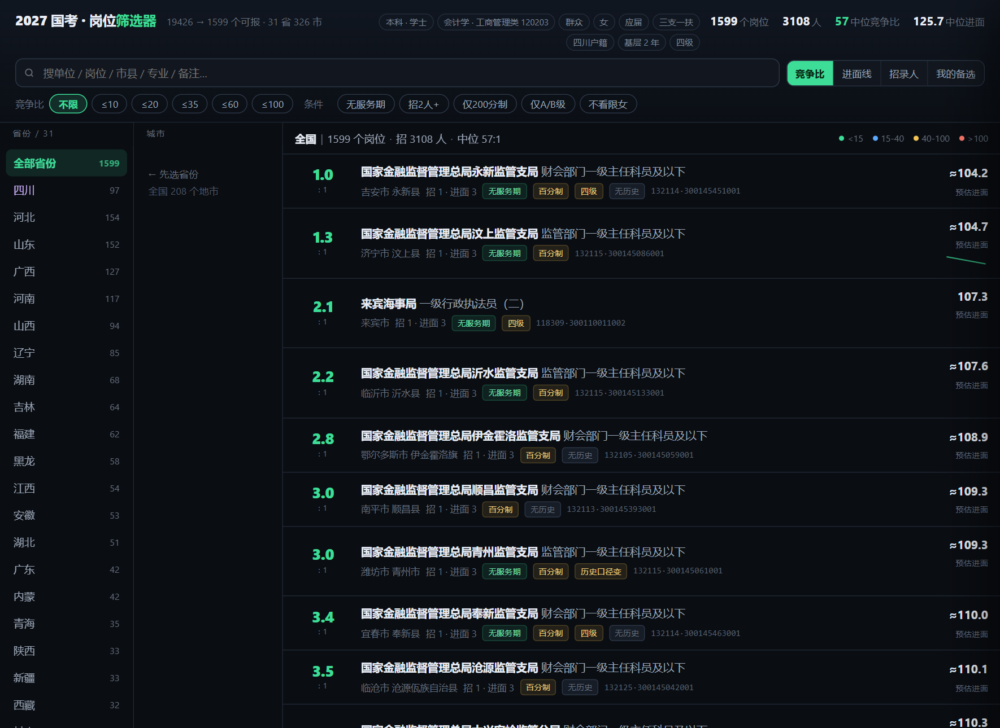
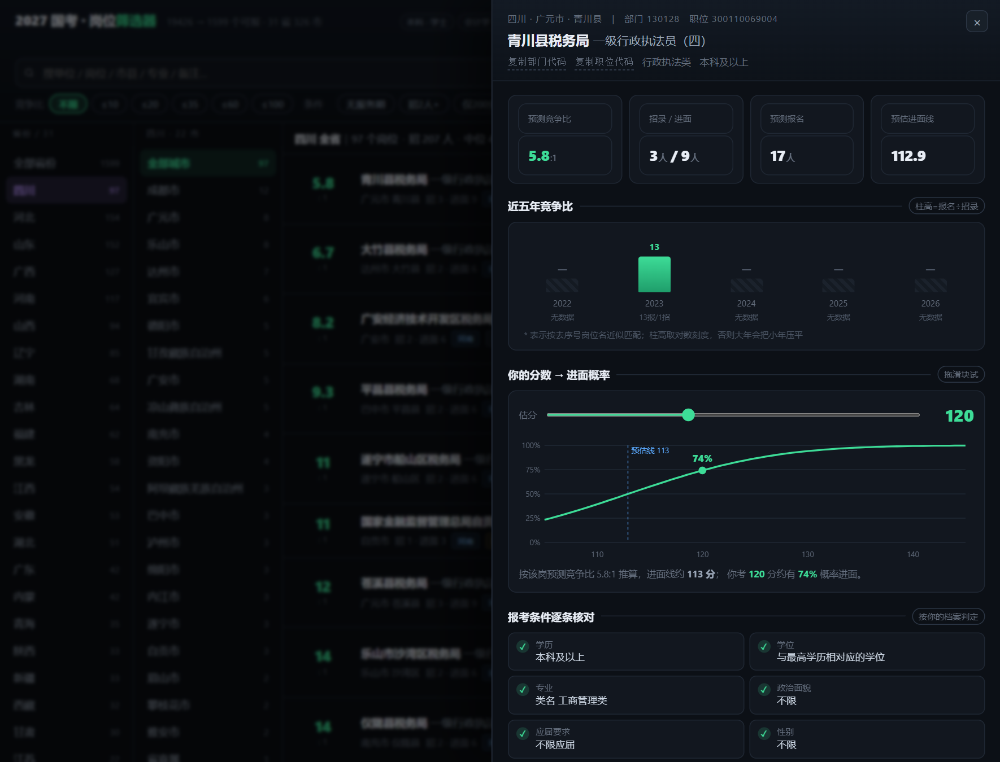

# gk-position-screener · 国考岗位筛选器 Skill

**离线跑通「考生画像 → 全国国考岗位筛选」的工具型 Skill。**
自带 2027 国考职位表（19,426 个岗位）与 2022–2026 五年竞争数据（87,079 条记录），全程不需要联网检索。输入你的个人条件，输出一个双击就能打开的、可交互的全国岗位筛选器网页。

<p align="center">
  
</p>
<p align="center">
  
</p>

---

## 它解决什么问题

国考选岗的核心矛盾是：**职位表有 1.9 万个岗位，但 90% 以上你根本报不了**——专业卡、应届卡、性别卡、政治面貌卡、户籍卡、身份卡……而这些限制散落在职位表的不同字段和备注的一句话里。

传统做法是打开 Excel 一列列筛，漏掉一条备注就白报。这个 Skill 把「你能不能报」变成一套可复现的判定引擎：

| 输入 | 输出 |
|---|---|
| 考生画像（学历 / 专业 / 政治面貌 / 身份 / 户籍…） | 真实可报岗位清单 + 每岗竞争比预测 + 进面线预估 |
| —— | 一个自包含 HTML 筛选器（省 / 市 / 岗三栏，点岗看详情） |

## 核心特性

- **12 类硬门槛自动判定**：学历、学位、专业（含「本科：/研究生：」分段解析、方向限定识别）、政治面貌、应届、性别、户籍生源、基层年限、服务基层项目定向、四六级、专业测试、备注里的一句话陷阱（如人行岗的"2 年商业性金融机构工作经历"、公安特勤的"国家一级运动员"）。
- **身份通道**：退役士兵、三支一扶、西部计划、特岗教师、大学生村官多选，自动解锁对应的定向岗位池（实测三支一扶画像可解锁 643 个定向岗）。
- **竞争量化**：优先用最近一年同名岗位的真实报名数做锚点，按供给结构调整预测；置信度 A/B/C/D 分级，A 级 = 上年同名岗实测。
- **进面线预估**：`分 = 103.21 + 5.53 × ln(竞争比)`（基于 33 个真实岗位回归，MAE 2.1 分），有实测进面分的省份直接用官网数据。
- **详情抽屉**：点任何岗位 → 五年竞争比柱状图、历年进面线折线、**你的估分 → 进面概率曲线**（可拖滑块）、12 项条件逐条核对、同市岗位对比、自动大小年报警。
- **纯前端产物**：HTML 双击即开，数据内嵌，无网络、无依赖、可发给别人。

## 快速开始

```bash
# 1. 写考生画像（结构见 examples/profile.example.json）
cp examples/profile.example.json my_profile.json
# 编辑 my_profile.json，填入真实条件；不适用的字段直接删掉

# 2. 三条命令出结果
python scripts/screen.py     --profile my_profile.json --out screened.json --explain --top 15
python scripts/enrich.py     --screened screened.json  --profile my_profile.json --out filter_data.json
python scripts/build_html.py --data filter_data.json   --profile my_profile.json --out "国考岗位筛选器.html"

# 3. 双击打开 HTML
```

依赖：仅 Python 3.8+ 标准库（gzip / json / re / math / statistics / argparse），无第三方包。

## 作为 Agent Skill 使用

本仓库同时是一个 [Agent Skill](https://agent-skills.spec)（`SKILL.md` + 脚本 + 数据包结构）。如果你的 AI 助手支持 Skill 机制，把整个目录放进 skills 目录即可，`SKILL.md` 已写明触发词（"筛岗位""竞争比""好考的岗位""退役士兵报岗"等）与四阶段工作流：**采集画像 → 筛选 → 补全 → 交付解读**。

画像采集有讲究：**身份类型是最大的隐藏变量**——它决定能否解锁定向岗位池，漏问一次可能丢掉几百个低竞争岗位。完整字段定义见 [references/profile-schema.md](references/profile-schema.md)。

## 目录结构

```
gk-position-screener/
├── SKILL.md                  # Skill 入口：触发词、工作流、硬性要求
├── scripts/
│   ├── gk_lib.py             # 画像匹配引擎（12 类门槛判定，每条判定带依据）
│   ├── screen.py             # 阶段1：19426 → 可报池（--explain 显示每类淘汰数）
│   ├── enrich.py             # 阶段2：补省市县、五年历史、进面线、条件核对表
│   ├── build_html.py         # 阶段3：渲染自包含 HTML 筛选器
│   └── update_data.py        # 数据维护：明年换职位表 / 追加竞争数据
├── data/                     # 离线数据包（gzip，共 2.2MB）
│   ├── positions_2027.json.gz    # 2027 职位表 19,426 条 × 23 字段
│   ├── rank_2022_2026.json.gz    # 五年竞争记录 87,079 条
│   ├── scores_henan.json.gz      # 河南五年进面线 4,410 条（其他省可按同格式扩充）
│   └── MANIFEST.md               # 数据口径与更新说明
├── references/               # 模型与规则文档
│   ├── profile-schema.md     # 画像字段定义
│   ├── filter-rules.md       # 12 类门槛的判定规则与正则
│   ├── scoring-model.md      # 竞争比预测与进面线回归模型
│   └── pitfalls.md           # 真实职位表踩坑记录（本文档最有价值的部分之一）
├── assets/filter_template.html   # 筛选器模板（占位符参数化）
├── examples/profile.example.json # 画像示例
└── docs/                     # 截图
```

## 数据说明

| 文件 | 内容 | 规模 |
|---|---|---|
| `positions_2027.json.gz` | 官方职位表精简版（23 个参与筛选/展示的字段） | 19,426 条 |
| `rank_2022_2026.json.gz` | 历年报名人数 / 过审人数 / 招录人数，按年分键 | 5 年 87,079 条 |
| `scores_henan.json.gz` | 河南省历年进面最低分（官网面试名单整理） | 4,410 条 |

口径要点（详见 [data/MANIFEST.md](data/MANIFEST.md)）：

- 竞争比 = 报名人数 ÷ 招录人数；同一（单位，岗位名）可能有多条记录（不同专业组），匹配时必须带招录人数或做去序号处理。
- 金融监管 / 证监 / 公安 / 边检岗位笔试为**百分制**，分数不可与 200 分制混排（页面已标注）。
- 职位表是官方发布日快照，**报名前务必到官方渠道核对**。

## 预测模型（摘要）

- **报名人数预测**：优先 `最近一年同名岗实测 × 供给结构调整`（省级供需弹性 β=0.36，年度自然增长 5%）；历史份额 >60% 的岗视为"不限专业年代"主力岗，旧数据不可沿用，降级按单位均分估算。
- **进面线预估**：200 分制下 `分数 = 103.21 + 5.53 × ln(竞争比)`；县域岗位按本地实测点二次校准。
- **进面概率**：考生分数服从 N(μ, σ)，`μ=109、σ=10.9`（33 岗回归，R²=0.887）；进面线 = μ + σ·Φ⁻¹(1 − 3n/N)。招录人数是最大杠杆——同样 120 分，招 2 人岗位的进面率可以是招 1 人岗位的 7 倍。

完整推导与可复算步骤见 [references/scoring-model.md](references/scoring-model.md)。

## 已知陷阱（节选，完整版见 references/pitfalls.md）

- **专业类陷阱**：电子信息工程（0807）≠ 计算机类（0809），岗位只写"计算机类"时报不了；"电子信息工程（航空电子方向）"这类方向限定也不算对口。
- **备注一句话陷阱**：性别（"男性"两个字淘汰 48/371）、户籍（"XX 市户口或生源"）、"在本单位最低服务年限为 5 年"、"2 年以上商业性金融机构工作经历"（服现役不算）。
- **职位代码跨省重复**：同一职位代码可能同时被 4 个省使用，定位岗位必须用「部门代码 + 职位代码」组合。
- **"零报名"不是机会**：报名不足 3:1 的岗位会被取消；零报名岗通常有证书/经历硬门槛。

## 更新一年的数据

```bash
# 新年度职位表发布后（Excel 另存为 JSON 后）：
python scripts/update_data.py --positions 新职位表.json --year 2028

# 或从既有工作目录整包更新（职位表 + 新一年竞争数据 + 进面分）：
python scripts/update_data.py --src <工作目录> --year 2028
```

## 免责声明

- 本项目所有数据来自公开渠道（官方职位表、历年报名统计、面试名单），仅作选岗参考，**不构成报考建议**；最终以官方公告为准。
- 预测值（竞争比、进面线、概率）均为统计估算，存在不可消除的误差，请结合报名期每日公布的实际人数动态校准。
- 请遵守目标网站的服务条款；本仓库不包含任何需要登录才能获取的数据。

## License

[MIT](LICENSE)
